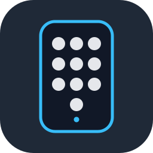

# Yale Access

A Home Assistant custom integration for listing Yale lock users and managing guest
PINs through Home Assistant's authenticated WebSocket API. Administrators and guest
managers receive different access, and residents can view and change their own code.
Login and configuration are handled in Home Assistant. The integration includes a
login health sensor; code management uses your own dashboard.

**Unofficial, not affiliated with Yale or ASSA ABLOY.** This integration uses the Yale
Home app's API and may break when the app changes.

## Features

- Create random or chosen PINs with always-valid or temporary access.
- View and change codes, update validity, and end PIN access.
- List names, status, validity, creator, and the latest PIN or app unlock within 90 days.
- Keep expired guest codes available for reuse after a validity update.
- Limit guest managers to their own guests and explicitly assigned Yale users.
- Protect resident accounts from guest lists and access removal.
- Refresh the app session automatically and alert when a new login is needed.

## Requirements

- A Yale lock with a keypad and a working Yale Connect / Wi-Fi bridge.
- A Yale Home account with owner rights for the lock.
- Home Assistant **2026.10.0 or newer**.

One lock is configured per Home Assistant installation.

## Installation

### HACS

1. In HACS, open the menu and select **Custom repositories**.
2. Add `https://github.com/mikkelke/ha-yale-access` with category **Integration**.
3. Find **Yale Access** and download it.
4. Restart Home Assistant, then follow [Setup](#setup).

### Manual

1. Download the repository and copy `custom_components/yale_access` into your Home
   Assistant configuration directory's `custom_components` folder.
2. Restart Home Assistant, then follow [Setup](#setup).

## Setup

1. Open **Settings → Devices & services → Add integration → Yale Access**.
2. Confirm the two-letter uppercase country code. It defaults to Home Assistant's
   configured country, or `US` when no country is configured.
3. Choose **Email** or **Phone**, enter your Yale account identifier and password,
   and submit.
4. If Yale requires verification, enter the six-digit code it sends you.
5. If your account has several locks, select the lock to manage. A single lock is
   selected automatically. The account must have access to at least one lock.

One lock is supported per Home Assistant installation. The integration starts with
no people configured, so access to its WebSocket API is denied until you configure
people below.

## Configuration

Open **Settings → Devices & services → Yale Access → Configure**. Each saved change
reloads the integration.

- **Person:** Select an active Home Assistant user, then set their role to `admin`
  or `guests`. Optionally select their own Yale user for own-code controls and
  assign other Yale users they should manage. Select `none` to remove that person's
  integration access.
- **Protected users:** Select Yale users to hide from lists and protect from access
  changes. Include owner and resident accounts you want protected. Own-code controls
  still work for the configured resident.
- **Notifications:** Optionally select a current `notify.*` service for the
  administrator's login-health alerts. Leave it empty to disable notifications.

Yale choices show each user's name and either their keypad slot or “app user”,
including protected users. Each Yale user can be selected as an own or assigned
user only once across all people. The same user may also be protected. Configuration
requires the integration to be loaded.

## Login health and reauthentication

The session refreshes as Yale returns new tokens. `sensor.yale_access_login` reports
`ok`, `expiring` (less than 14 days remaining), or `failed`, with an expiry attribute.
A failed session starts Home Assistant's reauthentication flow and sends one alert
per failed episode through the optional notification service:

> Yale Access needs a new login. Open Settings → Devices & services to re-authenticate.

Open the integration in **Settings → Devices & services** and complete the login
and, if requested, verification steps again. Use an account that can still access
the configured lock. Successful reauthentication reloads the integration and keeps
its people, protection and notification settings.

## Roles and visibility rules

- **`admin`** can list and manage every unprotected user on the configured lock.
- **`guests`** can list and manage guests they created through this integration, plus
  Yale users assigned to them through `yale_users`. They must supply a start and end
  when creating access or changing validity. Other users appear absent.
- **Protected users** are hidden from lists for every role, including admins. Their
  occupied PIN slots remain reserved. Their PINs and access cannot be changed here,
  except that a resident can view and change their configured `own_yale_user` PIN.
- **Own access** is separate from list visibility. A configured resident can use `me`,
  `pin`, and `set_pin` for their own code. No role can change its own access period
  or end its own access through this integration.

Ownership is recorded by the authenticated Home Assistant creator id. Explicit
assignments grant additional access without changing that record. Yale account
permissions still apply to every request.

## WebSocket API

Send commands as `{"id": n, "type": "yale_access/<command>", ...}` over Home
Assistant's existing websocket. The caller is always `connection.user.id`; commands
never accept a creator id or role. Extra fields are rejected.

| Command | Fields | Result |
| --- | --- | --- |
| `yale_access/me` | none | `{"role": "admin", "pin_length": 6, "own": User}`; role may be `guests`, `own` is null if unconfigured or missing |
| `yale_access/users` | none | `{"users": [User]}` filtered to the caller's scope |
| `yale_access/create` | `name`, optional `from`, `to` and `pin` | `{"user": User, "pin": "<code>"}` |
| `yale_access/set_validity` | `user_id`, optional `from` and `to` | `{"user": User}`; refused for the caller's own user |
| `yale_access/pin` | `user_id` | `{"pin": "<code>"}` from the lowest loaded slot; allowed for the caller's own user |
| `yale_access/set_pin` | `user_id`, `pin` | `{"user": User}` with validity unchanged; allowed for the caller's own user |
| `yale_access/end` | `user_id` | `{"ok": true}` after confirmed removal; refused for the caller's own user |

`from` and `to` must both be supplied or both omitted. Use ISO datetimes with an
explicit UTC offset, for example `2026-10-29T14:00:00+01:00`; `to` must be later.
Admins can omit both for always-valid access; guest managers must supply both.
Recurring schedules are listed read-only
but can be revoked with `end`. Validity and PIN changes require a non-recurring PIN
credential; app-only schedules are read-only. Chosen codes must contain only ASCII
digits, match `pin_length`, and differ from other users' existing codes. Omitting
`pin` when creating a user generates a random code. `me` uses cached rows and code
length, refreshing first if needed, without an additional activity scan.

`User` contains `user_id`, `name`, `slot` (null for app-only users), `kind`
(`always`, `temporary`, `recurring`), `from`, `to`, `status`, `last_use`, and
`created_by`. Status is `scheduled`, `active`, `expired`, `pending`, or `failed`.
`created_by` is the assigned Home Assistant owner's display name, otherwise the
creator's name, or null for unassigned imported users. No matching unlock within
90 days means `last_use: null`.

Protected targets return `protected` to admins and `not_found` to guest managers.
Changing or ending the caller's own access returns `protected`. Writes are serialized
per lock and polled for confirmation for up to 180 seconds; an accepted HTTP request
alone does not confirm a change. An unrelated pending credential blocks writes
because Yale sync applies to the whole lock. Read refreshes reconcile pending changes.
On a `pending` error or disconnection, inspect the user list and Yale app before
retrying; do not blindly create the user again. Once loaded, an authorized caller
can retrieve the PIN with `pin`.

Ending an imported resident or app user's PIN access leaves their app membership
in place. An unverified PIN-only guest is removed by Yale after credential deletion.
Error codes are `forbidden`, `not_found`, `protected`, `invalid_format`, `read_only`,
`request_failed`, `upstream_unavailable`, `pending`, and `not_ready` when no entry
is loaded. Error messages contain no Yale response bodies or secrets.

## Building a UI

The integration has no frontend. Any dashboard connected to Home Assistant can call
the WebSocket commands above and build its own user list, guest form, or resident
code controls. Use each person's authenticated Home Assistant connection so the
configured visibility rules apply.

## Security notes

- The app token is stored privately by Home Assistant in `.storage/yale_access.session`,
  separately from the integration entry. Protect Home Assistant storage and backups;
  never include the token in source control, logs, or issue reports. Removing the
  integration deletes its session store. Passwords and verification codes are not saved.
- PINs are never logged or stored by the integration. They are returned only to an
  authorized caller through an explicit create or PIN request, and kept in memory
  only while processing requests. Tokens and PINs are excluded from entity states
  and attributes.
- Add owner and resident ids to `protected_users` to hide them and prevent access
  changes here. A resident's configured own-code controls remain available.
- Ownership storage contains creator and operation metadata, never PINs or tokens.
  Role and protected-user checks run before results are serialized.
- Mutation requests are not automatically retried. Redirects are disabled.

## Reporting issues

Open an [issue](https://github.com/mikkelke/ha-yale-access/issues) with your Home
Assistant and integration versions, lock model, country, command, error code, and
steps to reproduce. Redact names and ids from configuration and screenshots. Never
include storage files, tokens, passwords, PINs, or raw Yale API responses.
